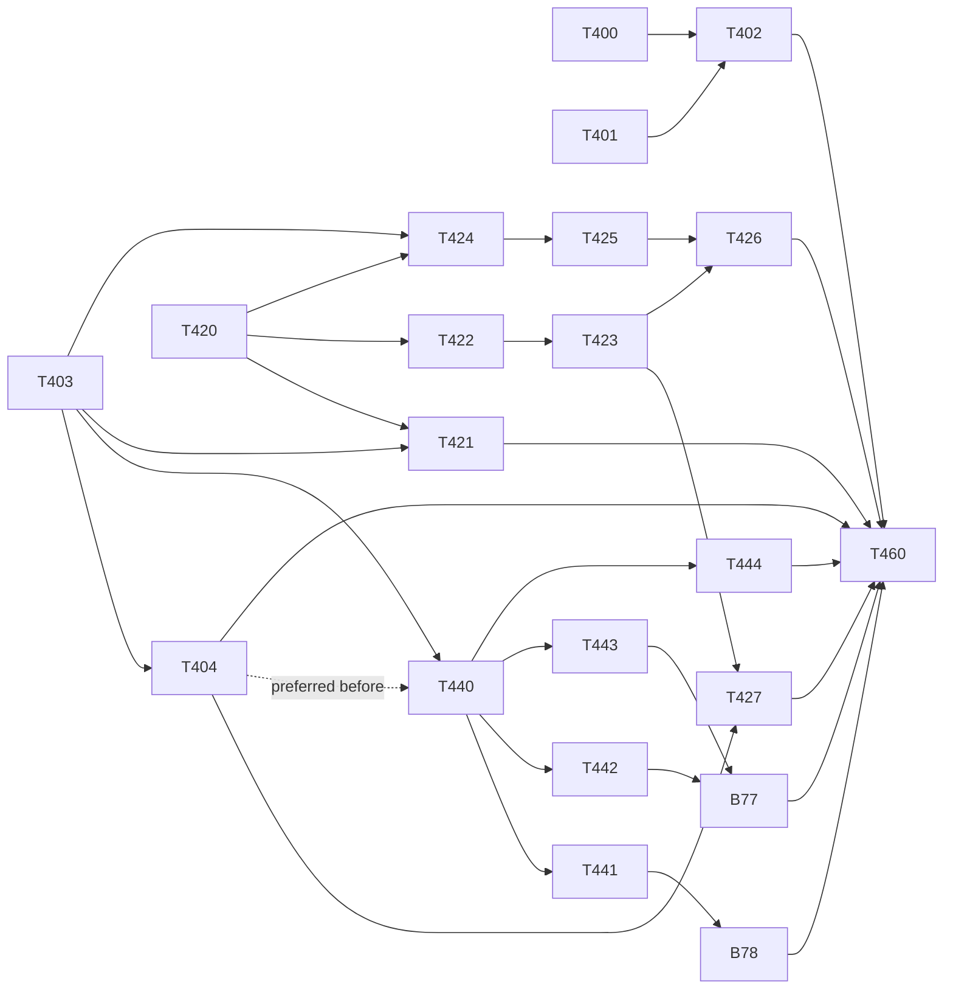

# Vertical slices, wave 1: overview of the three plans (merge order, dependencies, conflicts, parallel sessions)

> **For agentic workers:** REQUIRED SUB-SKILL: Use superpowers:subagent-driven-development (recommended) or superpowers:executing-plans to implement this plan task-by-task. Steps use checkbox (`- [ ]`) syntax for tracking.

**Goal:** Say in one place how the 20 tasks of the three wave 1 plans are ordered, which of them can run at the same time, where merge conflicts are expected and how they are solved, and close the wave with one check on `develop`.

**Architecture:** Three independent plans share a small set of files. All edits of the shared files are concentrated in four tasks (T403, T404, T440 on the frontend; T400 to T402 on the backend), which are ordered; everything else touches disjoint files and runs in parallel. This document adds no code of its own except the closing check (T460).

**Tech Stack:** as in the three plans; no new dependency in the whole wave.

**Spec:** [`docs/superpowers/specs/2026-10-31-vertical-slices-programme-design.md`](../specs/2026-10-31-vertical-slices-programme-design.md) sections 5 to 7; `Architecture/application/modular-monolith.md` sections 3, 4, 7, 9; ADR 17, 18, 19, 21.

**Plans:**
1. [`2026-11-10-vs-step1-settings.md`](2026-11-10-vs-step1-settings.md): `settings` module and the module template (T400 to T404, 5 tasks).
2. [`2026-11-10-vs-map-shell.md`](2026-11-10-vs-map-shell.md): map shell and its contribution points (T420 to T427, 8 tasks).
3. [`2026-11-10-vs-frontend-people-teams-devices.md`](2026-11-10-vs-frontend-people-teams-devices.md): frontend `people`, `teams`, `devices` (T440 to T444, B77, B78, 7 tasks).

**Base:** `upstream/develop` at `2472543` (T305 merged, checked on 2026-11-10: `backend/core/modules.py`, `backend/tests/architecture/`, `frontend/src/architecture.test.js`, `frontend/src/platform/manifest.js` are present).

## Global Constraints

- Decisions that are not reopened: base branch `upstream/develop`; kernel `backend/core/` and `frontend/src/platform/`; `main.py`, `db/migrate.py`, `version.py` stay; old imports are thin re-exports until step 5 (`sys.modules` alias on the backend, never `import *`); behaviour does not change; WebSocket security is not implemented; `fire_alert*` payloads are not touched; tests stay under `backend/tests/` and `frontend/src/**`.
- One task is one PR into `develop`. Every PR passes the smoke gate (`python tools/smoke.py`, `docs/SMOKE.md`) before it is opened, because a merge into `develop` deploys to bee-dev; then `breaker` and, where the plan's table says so, `security-reviewer` on the head commit; `gh pr create` is run by the human with `--body-file`.
- A conflict is solved by merging `upstream/develop` into the feature branch. No rebase, no force-push.
- Task numbers: T400 to T409 plan 1, T420 to T429 plan 2, T440 to T449 plan 3, T460 this file. No `T4xx` was in use before (checked with `git grep -nE "\bT4[0-9]{2}\b"`).

## Review Focus

1. Two sessions edit `MapView.vue` or `useMap.js` at the same time: a hand merge of a 1500-line file. The chains in section 2 forbid it.
2. A branch that is green alone and red after the other plan's PR is merged (shared i18n, router, module list): every later branch merges `upstream/develop` and reruns its DoD before review; T460 checks the sum.
3. The allowlists move in one direction only: after the wave the backend import allowlist has one line more than before (3 deleted, 4 added in T402, all approved with reasons) and the frontend allowlist is still empty. Any other number is a finding.
4. The owner merges `main` into `develop` during the wave (B62 to B67 touch `main.py` and `MapView.vue`): open branches of T400, T402 and of chain V merge `upstream/develop` again.
5. bee-dev is shared by human testers: a red smoke or a failed manual map check stops the PR, not only its merge.

---

## 1. Dependencies

Starting points with no dependency: T400, T401, T403, T420.

## 2. Merge order and parallel sessions

| Stage | Merged in this stage | Sessions at the same time | Why the stage is safe |
|-------|----------------------|---------------------------|-----------------------|
| A | T400, T401, T403, T420 | 4 | disjoint files: `main.py` and `core/modules.py`; `backend/tests/architecture/*`; frontend router, navigation, i18n and `platform/registry.js`; `platform/map-shell/*` and `platform/manifest.js` |
| B | T402, T404, T421, T422, T424 | 5 (4 recommended) | backend settings; frontend settings; `AppLayout.vue`; `useMap.js`; `MapView.vue`: five different hot files, one session each |
| C | T440, T423, T425 | 3 | T440 holds the shared frontend files alone (T404 is merged); chain U and chain V go on |
| D | T441, T442, T443, T444, T426, T427 | 6 (4 recommended) | three module folders, three store files, `MapView.vue`, `useMap.js` with `modules/settings` |
| E | B78, B77 | 2 | `people` view; `teams` and `devices` views |
| F | T460 | 1 | closing check on `develop` |

**How many sessions:** at most 4 at the same time is the recommendation, 6 is the ceiling the file ownership allows (stage D). The limit is not the files but the gates: every PR needs a smoke run (about 2 minutes, one container engine per machine), a breaker run, for 5 of the 20 tasks a security review, for 14 of them a manual look at the page, and each merge redeploys bee-dev. Of the frontend-designer sessions never more than one per chain: chain U (`useMap.js`: T422, T423, T427), chain V (`MapView.vue`: T424, T425, T426), `AppLayout.vue` (T421), and one per module view (T441, T442, T443).

Fixed orders inside the stages: T400 and T401 before T402; T403 before T404, T440, T421, T424; T404 before T440 (preferred) and before T427; T423 before T426.

## 3. Expected conflicts

| File | Tasks | Kind | Resolution |
|------|-------|------|------------|
| `frontend/src/modules/index.js` | T404, T440 | adjacent lines in the list | keep both; alphabetical order |
| `frontend/src/router/index.js` | T403, then T404 and T440 | T403 restructures the children; T404 and T440 delete different lines | merge T403 first; the two deletions do not touch (two lines between them) |
| `frontend/src/nav-config.js` | T403, then T404 and T440 | as the router | as the router |
| `frontend/src/i18n/en.js`, `bg.js` | T403, T404, T440 | T403 edits the first and last lines; the others cut different namespaces and non-adjacent `nav` lines | keep every deletion; `the merged dictionaries keep every key` (T403) is the proof |
| `frontend/src/modules/modules.test.js` | T403 creates; B77 edits two literals | none with another open task | |
| `frontend/src/modules/settings/index.js` | T404 creates; T427 adds two fields | ordered | T427 after T404 |
| `backend/main.py` | T400, T402 | ordered | T402 after T400 |
| `backend/tests/architecture/importlinter.toml`, `approved_additions.py`, `allowlist.json` | T401, T402 | ordered | T402 after T401; a conflict in the TOML is solved by taking both sides and running `regen.py --remove-stale` |
| `frontend/src/views/MapView.vue` | T424, T425, T426 | ordered chain | one session at a time |
| `frontend/src/composables/useMap.js` | T422, T423, T427 | ordered chain | one session at a time |
| `backend/main.py`, `frontend/src/views/MapView.vue` | this wave against the owner's `main` to `develop` merge (B62, B66, B67) | outside the wave | merge `upstream/develop` into the open branch, rerun its DoD and the smoke |
| `docs/superpowers/plans/2026-10-31-vs-phase0-1.bugs.md` | B77, B78 and other bug sessions | status lines of different entries | keep both |

No conflict is expected between plan 2 and plan 3: they share no file. Plan 2 and plan 1 share only `modules/settings/index.js` (ordered). Plan 3 and plan 1 share the four frontend assembly files (ordered through T403, then T404 before T440).

## 4. Reviewers per task

| Reviewers | Tasks |
|-----------|-------|
| breaker + security-reviewer | T400 (`main.py`, `core/**`), T402 (`routers/**`, `main.py`), T403, T404, T440 (`src/router/**`) |
| breaker | T401, T420 to T427, T441 to T444, B77, B78, T460 |
| ef-migration-reviewer | none: the wave has no migration |
| hardware validation | none: no file under `hardware_reader/` changes |

The plans themselves were reviewed by `task-reviewer` and `breaker` before hand-over (verdicts in the PR of the plan branch).

## 5. State after the wave

- Backend: `backend/modules/settings/` is the first module; `main.py` mounts routers and starts tasks from `MODULES`; `allowlist.json` has `completed_step: 1`; the import allowlist has 45 lines (44 before: 3 deleted, 4 added).
- Frontend: `src/modules/{devices,people,settings,teams}/`; routes, navigation and i18n come from the module list; `src/platform/map-shell/` holds the shell and four contribution points; the HQ marker is a manifest contribution; fire, SOS and the tracker features go through legacy entries marked with the step that moves them; `architecture.allowlist.json` is empty with `completed_step: 1`.
- Not done on purpose: backend `fire` (step 2), `tracking`, `sos`, `gateway` and the thin payload (step 3), the backends of `people`, `teams`, `devices` and the outbox (step 4), `identity`, `reporting`, `maps`, `simulation`, `weather` and the removal of the re-exports (step 5).

## 6. Open questions (collected from the three plans)

1. Step 1 leaves the backend import allowlist one line longer (settings calling fire until step 4). Accept, or bring the `HQCleared` event forward? (plan 1, item 1)
2. `useSettings.js` holds the tile-source choice and belongs to `maps`: move it into `settings` now as asked, or leave it until step 5? (plan 1, item 3)
3. The Settings page embeds fire zones, test mode and offline maps: step 2 needs a way for a module to contribute a section to that page. (plan 1, item 4)
4. Map shell scope: tracker, repeater, weather and basemap layers stay inside the `useMap` facade in this wave. Confirm, or ask for the tracker layers now. (plan 2, item 1)
5. The three stores have no consumer until step 3: build them now (T444) or with their first consumer? (plan 3, item 1)
6. `get_current_user` and `require_role`: every module imports them from `backend/auth.py`; proposal to move them to `backend/core/auth.py` in step 5. (plan 1, item 5)
7. To the owner: `fetch-depth: 0` in `ci.yml` so the growth tests run on PRs; `README.md` file tree; the `main` to `develop` reconcile (B62 to B67) before or during the wave.
8. To the architecture owner: the text proposals listed in each plan (modular-monolith.md sections 3.1, 3.2, 7, 8, 9).

---

### Task 460: closing check of wave 1 on `develop`

**risk:** normal
**owner:** implementer
**Files:**
- Create: `backend/tests/modules/core/test_wave1_state.py`
- Create: `frontend/src/modules/wave1.test.js`

**Interfaces:**
- Consumes: the merged result of every task of the three plans.
- Produces: two small test files that pin the state of section 5, so a later step that undoes part of the wave fails loudly. They are permanent tests, not a script.

- [ ] **Step 1: Merge check.** On a branch off the current `upstream/develop`, confirm with `git log --oneline upstream/develop` that the merge commits of T400 to T404, T420 to T427, T440 to T444, B77 and B78 are present; a missing one stops this task and is reported.
- [ ] **Step 2: Write the tests.** Backend, tagged `T460`: `test_settings_is_the_only_module_and_step_1_is_recorded` (`[m.name for m in backend.modules.MODULES] == ['settings']`; `allowlist.json` has `completed_step == 1`); `test_main_names_no_module_router` (the text of `backend/main.py` has no `settings_router`); `test_import_allowlist_size_after_wave_1` (`count_entries(<TOML text>, 'toml') == 45`; the message says which step is expected to lower it). Frontend, each `[T460]`: `the module list is devices, people, settings, teams` (names of `MODULES`, sorted); `the four pages are served by module routes` (`/settings`, `/users`, `/groups`, `/devices` resolve to routes named `settings`, `users`, `groups`, `devices`); `src/views holds no moved view` (`SettingsView.vue`, `UsersView.vue`, `GroupsView.vue`, `DevicesView.vue` do not exist there); `the frontend allowlist is empty at step 1` (`violations` is `[]`, `completed_step` is 1); `SOS is above the fire alarm and the HQ layer comes from the settings module` (`collectBanners(MODULES, LEGACY_BANNERS)` starts with `sos`; `collectMapLayers(MODULES)` contains the id `settings-hq`).
- [ ] **Step 3: Run the full suites and the smoke.** Run: `cd bee-with-me; .venv\Scripts\python -m pytest backend\tests -q`. Expected: PASS. Run: `cd bee-with-me\frontend; npm test; npm run build`. Expected: PASS and a clean build. Then `python tools/smoke.py`: every step PASS, including `g. GET /api/settings = 200`.
- [ ] **Step 4: Commit** `test(architecture): T460 pin the state after wave 1`. The PR body lists the open questions of section 6 that are still open.

dod:
- `cd bee-with-me; .venv\Scripts\python -m pytest backend\tests\modules\core\test_wave1_state.py backend\tests\architecture -q`
- `cd bee-with-me\frontend; npm test -- src/modules/wave1.test.js src/architecture.test.js`
- `cd bee-with-me\frontend; npm run build`
