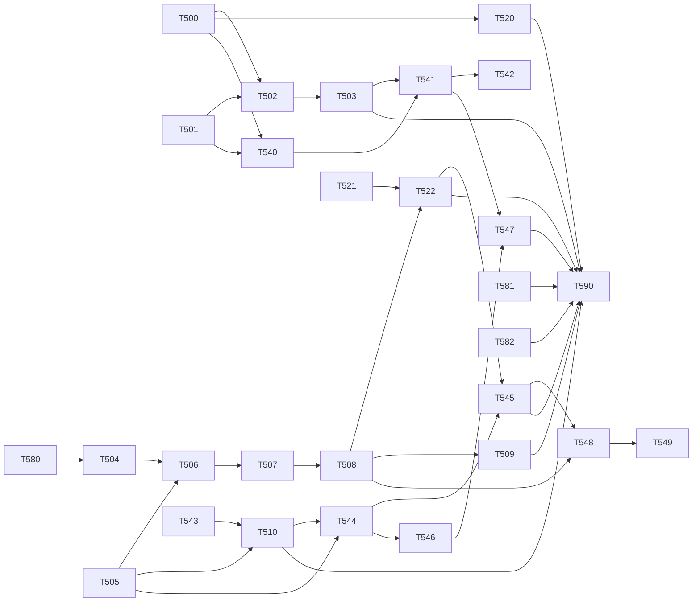

# Vertical slices, wave 2: overview of the three plans (merge order, dependencies, conflicts, parallel sessions)

> **For agentic workers:** REQUIRED SUB-SKILL: Use superpowers:subagent-driven-development (recommended) or superpowers:executing-plans to implement this plan task-by-task. Steps use checkbox (`- [ ]`) syntax for tracking.

**Goal:** Say in one place how the 28 tasks of wave 2 are ordered, which of them can run at the same time, where merge conflicts are expected and how they are solved; carry the three leftovers of wave 1 as tasks of their own; and close the wave with one check on `develop`.

**Architecture:** Three plans share a small set of hot files. Each hot file is given a chain: an ordered list of the tasks that may edit it, one session at a time. Everything outside the chains touches disjoint files and runs in parallel. This document adds four tasks of its own: T580 to T582 (leftovers of wave 1) and T590 (the closing check).

**Tech Stack:** as in the three plans; no new dependency in the whole wave.

**Spec:** [`docs/superpowers/specs/2026-10-31-vertical-slices-programme-design.md`](../specs/2026-10-31-vertical-slices-programme-design.md) sections 5, 6, 7, 9; `Architecture/application/modular-monolith.md` sections 3, 4, 5.1, 7, 9; ADR 17, 18, 19, 21; `Architecture/principles/architecture-principles.md`.

**Plans:**
1. [`2026-11-10-vs-step2-fire.md`](2026-11-10-vs-step2-fire.md): the `fire` module on both sides, the route-type guard of the loader (B96), the direction ratchet, the panel contribution point (T500 to T510, 11 tasks).
2. [`2026-11-10-vs-step2-weather.md`](2026-11-10-vs-step2-weather.md): the `weather` module on both sides; the tile layer stays in the facade (T520 to T522, 3 tasks).
3. [`2026-11-10-vs-step2-tracking-sos.md`](2026-11-10-vs-step2-tracking-sos.md): `tracking` and `sos` on both sides without the gateway, the live dispatch, the thin payload (T540 to T549, 10 tasks, of which T542, T548 and T549 are detachable).

**Base:** `upstream/develop` at `7f874bc` (PR #125, T460 merged, checked on 2026-11-10 with `git fetch upstream; git log --oneline upstream/develop`).

## Global Constraints

- Decisions that are not reopened: base branch `upstream/develop`; kernel `backend/core/` and `frontend/src/platform/`; `main.py`, `db/migrate.py`, `version.py` stay; old imports are thin re-exports until step 5 (`sys.modules` alias on the backend, never `import *`); behaviour does not change; WebSocket security is not implemented; auth is the loader's default and a public route is declared in the manifest; the shell contract of T422 and T423 is not changed; `lib/groups.js` stays; the stores of `people`, `teams` and `devices` (T444) wait for step 4; error isolation of contributions stays; `fire_alert*` payloads are not touched; `hardware_reader/parser.py` and `hid_reader.py` are not opened.
- One task is one PR into `develop`. Every PR passes the smoke gate (`python tools/smoke.py`, `docs/SMOKE.md`) before it is opened, because a merge into `develop` deploys to bee-dev; then `breaker` and, where section 4 says so, `security-reviewer` on the head commit; `gh pr create` is run by the human with `--body-file`.
- A conflict is solved by merging `upstream/develop` into the feature branch. No rebase, no force-push.
- Task numbers: T500 to T510 plan 1, T520 to T522 plan 2, T540 to T549 plan 3, T580 to T590 this file. No `T5xx` was in use before (`git grep -nE "\bT5[0-9]{2}\b"` on `7f874bc` prints nothing). B96 keeps its bug number; the three leftovers get task numbers, not bug numbers, so no session has to reserve one in the shared bugs file.
- Entry chunk base: **167,61 kB** on `develop` at `7f874bc` (the wave 1 plans said about 161 kB). Every frontend PR states the size before and after.

## Review Focus

1. Two sessions edit `MapView.vue` or `useMap.js` at the same time: a hand merge of a 1400-line file. The map chain of section 2 forbids it; nine tasks of the wave are links of that one chain.
2. A branch that is green alone and red after another plan's PR is merged (module list, dictionaries, `registry.py`, `importlinter.toml`, `useWebSocket.js`): every later branch merges `upstream/develop` and reruns its DoD before review; T590 checks the sum.
3. The allowlists move as the plans say and in no other way. After the wave: import allowlist 35 lines (45 before: 22 deleted in T502, T503, T520 and T540; 12 added, all alias or shim edges `until step 5`, all approved); `sql_writes` 8 rows with T542, 11 without it (21 before); `module_edges` 12 rows (new ratchet); frontend allowlist still empty. Any other number is a finding.
4. The thin payload goes out in two steps and the order matters: the frontend that handles both shapes (T546) is on bee-dev before the backend that sends the thin shape (T547) is merged.
5. bee-dev is shared by human testers and its only data source is the simulation: a red smoke step e (`simulated frame reaches /ws`) or a failed manual map check stops the PR, not only its merge.

---

## 1. Dependencies

Starting points with no dependency: T500, T501, T505, T521, T543, T580, T581, T582. Detachable ends: T542 (hardware decision), T548 and T549 (maintainer decision); T590 does not wait for them.

## 2. Chains (one session at a time per chain)

| Chain | Hot file(s) | Order |
|-------|-------------|-------|
| map | `frontend/src/views/MapView.vue`, `frontend/src/composables/useMap.js` | T580, T504, T506, T507, T508, T522, T545, then T548 and T549 if approved |
| assembly | `frontend/src/modules/index.js`, `frontend/src/i18n/en.js`, `bg.js` | T505, T521, T544 (any two may overlap: the edits are different lines; the later branch merges `upstream/develop`) |
| live | `frontend/src/composables/useWebSocket.js`, `composables/legacyLive.js` | T543, T510, T544 |
| banners | `frontend/src/components/legacyBanners.js`, `AppLayout.vue` | T505, T544 |
| backend assembly | `backend/main.py`, `backend/modules/registry.py`, `backend/tests/architecture/importlinter.toml`, `approved_additions.py`, `allowlist.json` | T502, T503, T520 (any time after T500), T540, T541, T542, T547 |
| caller block | `backend/routers/devices.py:206-239` | T503, then T541 |
| smoke | `tools/smoke.py`, `backend/tests/test_smoke_script.py`, `docs/SMOKE.md` | T502 (step h), T520 (step i), T540 (step j): adjacent lines, keep all |
| manifest contract | `frontend/src/platform/manifest.js`, `platform/map-shell/contributions.js` | T504 (`panels`, `toggle`), T543 (`live`), T548 (`actions`) |

## 3. Merge order and parallel sessions

| Stage | Merged in this stage | Sessions at the same time | Why the stage is safe |
|-------|----------------------|---------------------------|-----------------------|
| A | T500, T501, T543, T580, T505, T581, T582 | 7 possible, 4 recommended | `core/modules.py`; architecture tests; `useWebSocket.js`; the map chain's first link; fire store, libs and banner; three module views; two state tests: no file in common |
| B | T502, T520, T504, T521, T510 | 5 (4 recommended) | T502 and T520 share only the backend assembly files (one line each, keep both); T504 is the map chain; T521 the assembly chain; T510 the live chain |
| C | T503, T506, T544 | 3 | backend chain; map chain; assembly, live and banner chains (T505, T510, T521 are merged) |
| D | T540, T507, T546 | 3 | backend chain; map chain; the two new stores |
| E | T541, T508 | 2 | backend chain (after T503 for `devices.py`); map chain |
| F | T509, T522, T547, and T542 when it is released | 4 | `SettingsView.vue`; map chain; payload builders (T546 is deployed); `reader.py` alone |
| G | T545 | 1 | map chain |
| H | T548, then T549 (only if approved) | 1 | map chain |
| I | T590 | 1 | closing check on `develop` |

**How many sessions.** Four at the same time is the recommendation: one `frontend-designer` on the map chain (never two), one implementer on the backend chain, one session on the assembly and live chains, and one floating session for the tasks outside every chain (T500, T501, T520, T581, T582, T546, T509). Six is the ceiling the file ownership allows (stage A). The limit is the gates, not the files: every PR needs a smoke run (about 2 minutes, one container engine per machine), a breaker run, for 8 of the 28 tasks a security review, for 12 a manual look at the page, and each merge redeploys bee-dev.

**The critical path** is the map chain: seven PRs in sequence (nine with T548 and T549), each waiting for the one before it to be merged. Everything else finishes earlier. If the wave has to be shortened, T522 (weather UI) and T545 (toast) are the links that can wait for a later wave without leaving a legacy entry marked `until step 2` behind.

## 4. Expected conflicts

| File | Tasks | Kind | Resolution |
|------|-------|------|------------|
| `backend/modules/registry.py` | T502, T520, T540 | one import and one name each | keep all; tuple order `fire, settings, tracking, sos, weather` (fire stays first: `test_fire_routes_keep_their_place`) |
| `backend/main.py` | T502, T503, T520, T540 | each deletes one name of the `from .routers import` line and one `include_router` line; T503 also edits `lifespan` | keep every deletion; rerun `test_main_names_no_module_router` |
| `backend/tests/architecture/importlinter.toml` | T502, T503, T520, T540, T541 | new contracts at the end; every new module is appended to the `source_modules` of the others | take both sides, then `regen.py --remove-stale`; `check_boundary_contracts` names a missing source |
| `backend/tests/architecture/allowlist.json`, `approved_additions.py` | T501, T503, T541, T542 | rows of different keys | keep both; the exact-match tests name a stale or missing row |
| `backend/routers/devices.py`, `users.py` | T503 (fire imports, the lock block), T541 (the three DELETEs, the three UPDATEs) | adjacent lines in `delete_device_permanent` | T541 after T503 |
| `frontend/src/modules/index.js` | T505, T521, T544 | adjacent lines in the list | keep all, alphabetical: `devices, fire, people, settings, sos, teams, tracking, weather` |
| `frontend/src/i18n/en.js`, `bg.js` | T505 (`fire`, `fireAlarm`), T521 (weather keys of `map`), T544 (`sos`), T580 (one new key), T549 (one new key) | different namespaces | keep every deletion and addition; `no text key was lost`, the collision test and the parity test are the proof |
| `frontend/src/platform/manifest.js` | T504, T543, T548 | different optional fields | keep all |
| `frontend/src/modules/fire/index.js` | T505 creates; T506, T507, T508, T509, T510, T548 add one field each | ordered through the map chain; T510 is the only one outside it | T510 merges `upstream/develop` first |
| `frontend/src/composables/useWebSocket.js`, `legacyLive.js` | T543, T510, T544 | ordered chain | one at a time |
| `frontend/src/views/MapView.vue`, `frontend/src/composables/useMap.js` | the map chain | ordered chain | one session at a time |
| `tools/smoke.py`, `test_smoke_script.py`, `docs/SMOKE.md` | T502, T520, T540 | adjacent `self.step(...)` lines and table rows | keep all, letters h, i, j |
| `backend/main.py`, `MapView.vue` | this wave against the owner's `main` to `develop` merge (B62, B66, B67) | outside the wave | merge `upstream/develop` into the open branch, rerun its DoD and the smoke |
| `docs/superpowers/plans/2026-10-31-vs-phase0-1.bugs.md` | T500 (status of B96), bug sessions | status lines of different entries | keep both |

## 5. Reviewers per task

| Reviewers | Tasks |
|-----------|-------|
| breaker + security-reviewer | T500 (`core/**`), T502, T503 (`routers/**`, `main.py`), T520 (`routers/**`, `main.py`), T540, T541 (`routers/**`, `main.py`), T542 (`hardware_reader/**`), T547 (`routers/**`, the content of the open live channel) |
| breaker | T501, T504 to T510, T521, T522, T543 to T546, T548, T549, T580, T581, T582, T590 |
| ef-migration-reviewer | none: the wave has no migration |
| hardware validation | T542 carries the hardware note; whether it is run on a real gateway before the merge is the owner's and the device maker's decision (plan 3, section 6, item 2) |
| manual look at the page | T504 to T509, T522, T545, T548, T549, T580, T581 |

The plans themselves were reviewed by `task-reviewer` and `breaker` before hand-over (verdicts in the PR of the plan branch).

## 6. State after the wave

- Backend: `backend/modules/{fire,settings,sos,tracking,weather}/`; `main.py` mounts no router of these five and starts no fire task; `backend/fire/*`, `backend/routers/{fire,weather}.py` are aliases and `backend/routers/locations.py` is a named shim, all until step 5; every writer of `location_events`, `repeater_events`, `sos_alerts` and `fire_alerts` outside its module goes through that module's `api.py` (the retention DELETE in `main.py` is the one exception, `until: 5`); `allowlist.json` has `completed_step: 2`.
- Live channel: `location_update` and `sos_alert` carry ids and position data only (R-22); `fire_alert*` is unchanged.
- Frontend: `src/modules/{devices,fire,people,settings,sos,teams,tracking,weather}/`; no legacy banner, popup, context-menu or map entry is left; live messages are dispatched to manifest handlers; `MapView.vue` holds the shell wiring, the toolbar, HQ and repeater placement, measuring and (unless T548 ran) the tracker panel; `useMap.js` holds the basemaps, the graticule, measuring, the repeater layer, the weather tile layer and (unless T549 ran) the tracker layers; `architecture.allowlist.json` is empty with `completed_step: 2`.
- Not done on purpose: the `gateway` module, the hardware path fix (R-06) and the rest of step 3; the backends of `people`, `teams`, `devices` and the outbox (step 4); `identity`, `reporting`, `maps`, `simulation`, the weather tile layer and the removal of the re-exports (step 5).

## 7. Open questions (collected from the three plans)

1. **To the owner and the device maker:** T542 edits `hardware_reader/reader.py` without touching decode, duplicate filter or ACK. Validate on a real gateway before the merge, or let it wait for the gateway step? (plan 3, item 2)
2. **To the device maker:** does anything outside the browser read names, phones, photo paths or teams from `location_update` or `sos_alert`? T547 waits for the answer. (plan 3, item 3)
3. **To the maintainer:** the tracker panel (T548) and the tracker layers (T549) in this wave, or with the gateway step? (plan 3, item 1)
4. **To the maintainer:** a manifest may import its store and its alarm banner statically, so the entry chunk grows; keep that, or add a second entry file per module? (plan 1, item 2)
5. **To the maintainer:** nine alias files for `backend/fire/*` until step 5, or import-path edits in 25 test files now? (plan 1, item 1)
6. **To the owner:** the reverse calls into `fire`, `tracking` and `sos` from `settings`, `users`, `devices` (8 rows, `until: 4`) and from the simulation (4 rows, `until: 3`) are named debt in `module_edges`. Accept, or bring the events of step 4 forward? (plans 1 and 3)
7. **To the architecture owner:** the text proposals listed in each plan (modular-monolith.md 3.1, 3.2, 4.1, 4.2, 5.1, 7, 8; `api-contracts.md`), and the two internet URLs the weather panel uses from the browser (TP-01). (plan 2, item 3)
8. **To the owner (carried from wave 1):** `fetch-depth: 0` in `ci.yml` so the growth tests run on PRs; `README.md` file tree; the `main` to `develop` reconcile (B62 to B67).
9. Retention stays in `main.py` although the spec moves it to `tracking.tasks` in step 3 (four tests and the allowlist say step 5). Confirm. (plan 1, item 4)

---

### Task 580: a failed HQ layer must not leave placement mode on without a word (leftover of T427)

**risk:** normal
**owner:** frontend-designer
**Files:**
- Modify: `frontend/src/composables/useMap.js` (lines 799 to 812: `settingsMapFn`, `setHQ`, `setHQPlacementMode`)
- Modify: `frontend/src/views/MapView.vue` (`toggleHQMode`, the `bm-hq-error` notes of the toolbar)
- Modify: `frontend/src/i18n/en.js`, `bg.js` (one key in the `map` namespace)
- Create: `frontend/src/composables/useMap.hqSignal.test.js`, `frontend/src/views/MapView.hqSignal.test.js`

**The defect.** When the `settings` map entry fails to install, `setHQPlacementMode` is a no-op that logs once to the console (T427). `MapView.vue` still sets `hqMode` to true: the button looks pressed, the hint shows, and a click on the map places nothing. The operator gets no signal (BP-03).

**Interfaces:**
- Produces in `useMap.js`: `setHQPlacementMode(on)` returns `true` when the settings entry handled the call and `false` when the entry is missing; `setHQ` is unchanged. The console line stays.
- Produces in `MapView.vue`: `toggleHQMode` switches `hqMode` on only when `setHQPlacementMode(true) !== false` (a strict comparison, so the mocked facade of the existing tests, which returns `undefined`, behaves as today); otherwise `hqMode` stays `false` and a note with `role="alert"` and the class `bm-hq-error` shows `t('map.hqLayerFailed')`.
- Produces the texts: EN `map.hqLayerFailed`: "The HQ layer could not be loaded. Reload the page."; BG: "Слоят на щаба не се зареди. Презаредете страницата."

- [ ] **Step 1: Write the failing tests**, each `[T580]`. `useMap.hqSignal.test.js` (the set-up of `useMap.hqFallback.test.js`): `setHQPlacementMode returns false and switches no mode when the settings entry is missing`; `it returns true with the real entry`. `MapView.hqSignal.test.js` (the mock set-up of `MapView.test.js` copied, with `setHQPlacementMode: () => false`): `the HQ button does not stay pressed and an alert says the layer failed`; `with a facade that returns nothing the button works as today`.
- [ ] **Step 2: Run, expect FAIL.** Run: `cd bee-with-me\frontend; npm test -- src/composables/useMap.hqSignal.test.js src/views/MapView.hqSignal.test.js`. Expected: FAIL (`setHQPlacementMode` returns `undefined`; the button has the class `active`).
- [ ] **Step 3: Implement.**
- [ ] **Step 4: Run.** Run: `cd bee-with-me\frontend; npm test -- src/composables src/views src/modules src/i18n src/architecture.test.js; npm run build`. Expected: PASS and a clean build.
- [ ] **Step 5: Commit** `fix(map): T580 a failed HQ layer is shown and placement mode stays off`.

dod:
- `cd bee-with-me\frontend; npm test -- src/composables src/views src/modules src/i18n src/architecture.test.js`
- `cd bee-with-me\frontend; npm run build`

### Task 581: the weak spots of the B77 and B78 fixes (overlapping loads, late answers, error text)

**risk:** normal
**owner:** frontend-designer
**Files:**
- Modify: `frontend/src/modules/teams/views/GroupsView.vue`, `frontend/src/modules/devices/views/DevicesView.vue`, `frontend/src/modules/people/views/UsersView.vue` (only where step 1 shows a defect)
- Create: `frontend/src/modules/teams/views/GroupsView.t581.test.js`, `frontend/src/modules/devices/views/DevicesView.t581.test.js`, `frontend/src/modules/people/views/UsersView.t581.test.js`

**What is known.** The breaker's notes on B77 and B78 are recorded only as one line in the PR of T460: "a race between overlapping loads, out-of-order responses, `errorText` without a fallback key". Step 1 turns each into a test; a case that cannot be made to fail is kept as a passing test and reported as not reproducible.

**Interfaces:**
- Produces, where a test fails: each view's `load()` (and `GroupsView`'s group selection) keeps a sequence number and ignores an answer that is not the latest request's; `errorText(error)` returns the text of an existing i18n key when the error has no usable `detail` (the key the view already uses for a failed load), never `undefined` or an empty string.

- [ ] **Step 1: Write the tests**, each `[T581]`, per view, with `src/api` mocked and deferred promises: `the answer of an earlier load that arrives last does not replace the newer one` (two `load()` calls; the second resolves first with list B, the first later with list A: the table shows B); `an error of an earlier load does not replace the result of a newer successful one`; `an error without a detail shows the fallback text` (reject with `new Error('x')` and with `{ response: { data: {} } }`: the error element has a non-empty text that is the translation of the fallback key); for `GroupsView` also `selecting a second team before the first has loaded shows the second team's members`. Run: `cd bee-with-me\frontend; npm test -- src/modules/teams src/modules/devices src/modules/people`. Expected: the cases that show a defect FAIL; write the list of failing and passing cases into the PR body.
- [ ] **Step 2: Fix** each failing case with the smallest change of the view (sequence guard, fallback key). No markup, class or text changes.
- [ ] **Step 3: Run** the views' unedited tests and the new ones. Run: `cd bee-with-me\frontend; npm test -- src/modules; npm run build`. Expected: PASS and a clean build; run the three new files ten times in a row (`npm test -- src/modules/teams/views/GroupsView.t581.test.js --retry=0` in a loop) and report any flake.
- [ ] **Step 4: Commit** `fix(modules): T581 a late or failed load cannot overwrite a newer one in the people, teams and devices pages`.

dod:
- `cd bee-with-me\frontend; npm test -- src/modules`
- `cd bee-with-me\frontend; npm run build`

### Task 582: harden the three weak checks of T460

**risk:** normal
**owner:** implementer
**Files:**
- Modify: `backend/tests/modules/core/test_wave1_state.py` (`test_main_names_no_module_router`)
- Modify: `frontend/src/modules/wave1.test.js` (two cases)
- Create: `frontend/src/modules/olScan.js` (the scanner that `modules.test.js` holds today, moved so both files use it), and `frontend/src/modules/modules.test.js` imports it from there

**The weaknesses** (breaker notes on T460): the backend check matches the literal `settings_router` only, so a module router mounted by hand under another name passes; the frontend OpenLayers check of `wave1.test.js` looks for `from 'ol` in `modules/*/index.js` only and misses a side-effect import and everything a manifest imports; the route check depends on route names and a matched depth of 2.

**Interfaces:**
- Produces in `test_wave1_state.py`: `test_main_names_no_module_router` parses `backend/main.py` with `ast`, collects every `app.include_router(<name>.router)` call and every name imported by `from .routers import ...`, imports `backend.routers.<name>` for each and fails when the module it gets is a module under `backend.modules` (an alias) or re-exports the `router` of one (the named shim of `locations`): the message names the line. It still passes for the legacy routers.
- Produces in `olScan.js`: `staticOlChain(file) -> string[] | null` (the chain of static imports from `file` to an `ol` module; side-effect imports count; a dynamic `import()` does not), as `modules.test.js` has it today.
- Produces in `wave1.test.js`: `no manifest imports OpenLayers` uses `staticOlChain` for every manifest; `the four pages are served by module routes` checks, for each path, that the last matched record has the module's route name and that some matched record is the layout route (compared by its `component`), without a fixed depth.

- [ ] **Step 1: Write the failing tests**, tagged `T582`. Backend, in the same file: `test_the_router_check_bites_on_an_alias_and_on_a_shim` (the check, called as a function on a source text `from .routers import settings as s\napp.include_router(s.router)`, returns one problem; on `from .routers import auth\napp.include_router(auth.router)` none). Frontend, in `wave1.test.js`: `the OpenLayers scan sees a side-effect import and an import behind a helper` (two fixture manifests in a temporary folder: `import 'ol/ol.css'` and a manifest that imports a helper that imports `ol/Map`: both give a chain; a manifest with `() => import('ol/Map')` gives `null`).
- [ ] **Step 2: Run, expect FAIL.** Run: `cd bee-with-me; .venv\Scripts\python -m pytest backend\tests\modules\core\test_wave1_state.py -q` and `cd bee-with-me\frontend; npm test -- src/modules/wave1.test.js`. Expected: FAIL (the function does not exist; `Failed to resolve import "./olScan.js"`).
- [ ] **Step 3: Implement** the three hardenings; `modules.test.js` changes only its import of the scanner.
- [ ] **Step 4: Run.** Run: `cd bee-with-me; .venv\Scripts\python -m pytest backend\tests\modules\core backend\tests\architecture -q`. Expected: PASS. Run: `cd bee-with-me\frontend; npm test -- src/modules src/architecture.test.js`. Expected: PASS.
- [ ] **Step 5: Commit** `test(architecture): T582 the wave 1 state checks no longer depend on a literal name, a file pattern or a route depth`.

dod:
- `cd bee-with-me; .venv\Scripts\python -m pytest backend\tests\modules\core backend\tests\architecture -q`
- `cd bee-with-me\frontend; npm test -- src/modules src/architecture.test.js`

### Task 590: closing check of wave 2 on `develop`

**risk:** normal
**owner:** implementer
**Files:**
- Create: `backend/tests/modules/core/test_wave2_state.py`
- Create: `frontend/src/modules/wave2.test.js`
- Modify: `frontend/src/architecture.allowlist.json` (`completed_step`: 2)

**Interfaces:**
- Consumes: the merged result of every task of the three plans except the detachable ones (T542, T548, T549), whose state is reported, not asserted.
- Produces: two test files that pin what wave 2 reached, with lower bounds and membership only, so step 4 adds modules and removes allowlist rows without editing them.

- [ ] **Step 1: Merge check.** On a branch off the current `upstream/develop`, confirm with `git log --oneline upstream/develop` that the merge commits of T500 to T510, T520 to T522, T540, T541, T543 to T547 and T580 to T582 are present; a missing one stops this task and is reported. Note in the PR body whether T542, T548 and T549 are merged.
- [ ] **Step 2: Write the tests.** Backend, tagged `T590`: `test_fire_tracking_sos_and_weather_are_modules` (each name is in `[m.name for m in backend.modules.MODULES]`; `completed_step >= 2`); `test_main_names_none_of_them` (the text of `backend/main.py` has none of `fire_poller`, `fire_alarm`, `fire.router`, `locations.router`, `weather.router`); `test_the_old_fire_paths_are_aliases` (each of the nine old dotted paths imports as a module whose `__name__` starts with `backend.modules.fire`); `test_no_writer_outside_the_owning_module` (`allowlist.json` has no `sql_writes` row for `routers/test.py`, `routers/users.py`, `routers/devices.py`, and none for `simulation.py` on `location_events` or `sos_alerts`); `test_reverse_edges_are_named` (every `module_edges` row has `until` 3 or 4 and an approval); `test_live_messages_of_tracking_and_sos_are_thin` (the payload builders return no key of `tracking.api.PERSONAL_KEYS`); `test_no_module_router_holds_a_mount` (no route of any manifest router is a `Mount`, unless it is in `public_routes`). Frontend, each `[T590]`: `fire, sos, tracking and weather are modules`; `the banners are SOS then the fire alarm and no legacy list exists` (`collectBanners(MODULES).map(b => b.id)` equals `['sos', 'fire-alarm']`; `components/legacyBanners.js` and `composables/legacyLive.js` do not exist); `the fire layers, popup and menu item come from the manifest` (ids `fire-burnt`, `fire-zones`, `fire-hotspots`; `popupFor(collectPopups(MODULES), 'hotspot')` is not null; `collectContextMenu(MODULES)` has `fire-report-here`); `no source file still says until step 2` (no file under `src/` outside tests contains the text); `every live message type has a manifest handler` (the eight types of today are keys of `collectLiveHandlers(MODULES)`); `no manifest reaches OpenLayers` (the scanner of T582); `the frontend step is recorded` (`completed_step >= 2`).
- [ ] **Step 3: Run the full suites, the build and the smoke.** Run: `cd bee-with-me; .venv\Scripts\python -m pytest backend\tests -q`. Expected: PASS. Run: `cd bee-with-me\frontend; npm test; npm run build`. Expected: PASS and a clean build. Then `python tools/smoke.py`: every step PASS, including e, g, h, i and j. Write into the PR body: the entry chunk size (base 167,61 kB), the three allowlist counts of Review Focus item 3, and the open questions of section 7 that are still open.
- [ ] **Step 4: Commit** `test(architecture): T590 pin the state after wave 2`.

dod:
- `cd bee-with-me; .venv\Scripts\python -m pytest backend\tests\modules\core\test_wave2_state.py backend\tests\architecture -q`
- `cd bee-with-me\frontend; npm test -- src/modules/wave2.test.js src/architecture.test.js`
- `cd bee-with-me\frontend; npm run build`
