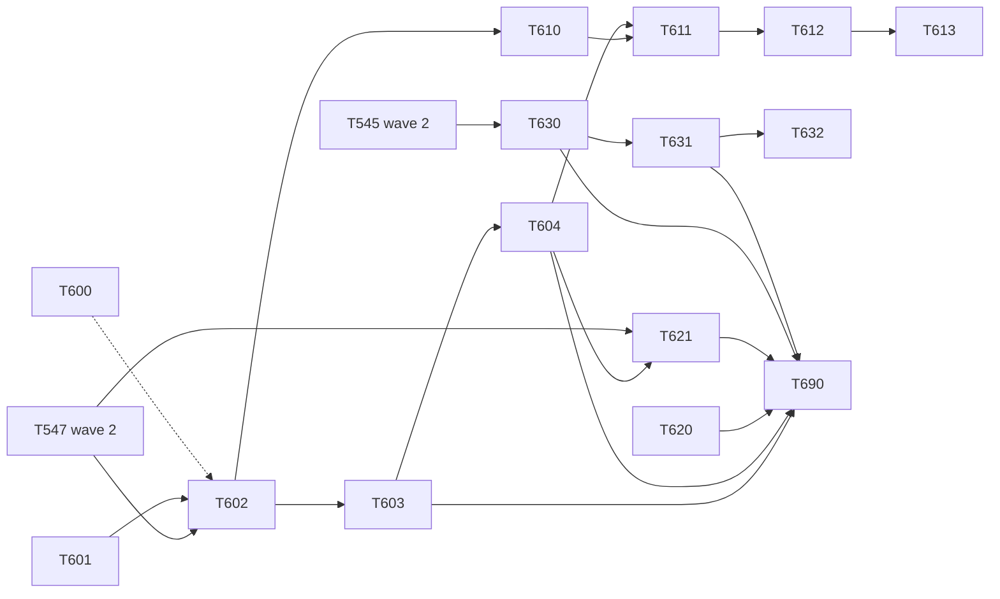

# Vertical slices, wave 3 (step 3: the gateway): overview of the four plans (merge order, chains, hardware gate, open questions)

> **For agentic workers:** REQUIRED SUB-SKILL: Use superpowers:subagent-driven-development (recommended) or superpowers:executing-plans to implement this plan task-by-task. Steps use checkbox (`- [ ]`) syntax for tracking.

**Goal:** Say in one place how the 15 tasks of wave 3 are ordered, which can start today without a gateway on the desk and which wait for one, which files are shared and in what order they are edited, what is asked from whom, and close the wave with one check on `develop`.

**Architecture:** Four plans. The gateway plan moves the hardware reader into a module without changing it and proves that with a hash pin. The hardware plan changes the duplicate filter and the ACK and is merged only after a run on a real gateway. The tracking plan takes the clean-up out of `main.py` and sends the simulation through the gateway. The frontend plan gives the gateway status a module and finishes the tracking contributions. This document adds one task of its own: T690, the closing check.

**Tech Stack:** as in the four plans; no new dependency and no migration in the whole wave.

**Spec:** [`docs/superpowers/specs/2026-10-31-vertical-slices-programme-design.md`](../specs/2026-10-31-vertical-slices-programme-design.md) sections 2, 5 ("Step 3"), 6, 9; `Architecture/application/modular-monolith.md` sections 3, 4, 5.1, 7, 9, 10; ADR 17, 18, 19, 20, 21; `Architecture/governance/risk-register.md` R-06, R-07, R-22; `docs/PROTOCOL.md`.

**Plans:**
1. [`2026-11-11-vs-step3-gateway-backend.md`](2026-11-11-vs-step3-gateway-backend.md): the allowlist tool, the hash pin, the `gateway` module, its task, `gateway.api` (T600 to T604, 5 tasks).
2. [`2026-11-11-vs-step3-hardware-path.md`](2026-11-11-vs-step3-hardware-path.md): outcomes and the ACK policy, ACK after store, no ACK for an unknown device, one transaction, and the validation protocol for the real gateway (T610 to T613, 4 tasks).
3. [`2026-11-11-vs-step3-tracking-leftovers.md`](2026-11-11-vs-step3-tracking-leftovers.md): retention and the fire clean-up as module tasks, the simulation through the gateway (T620, T621, 2 tasks).
4. [`2026-11-11-vs-step3-frontend.md`](2026-11-11-vs-step3-frontend.md): the frontend `gateway` module, the tracker panel and the tracker layers as `tracking` contributions (T630 to T632, 3 tasks; T631 and T632 are wave 2's T548 and T549 with new numbers).

**Base:** `upstream/develop` at `d174ce3` (PR #150, T542 merged; `git fetch upstream; git log --oneline -1 upstream/develop` on 2026-11-11).

## Global Constraints

- Decisions that are not reopened: those of wave 2's overview (base branch, kernel names, frozen files, aliases until step 5, auth by default, no WebSocket security work, `frontend-designer` for `.vue` and `.css`, the shell contract, `lib/groups.js`, `fire_alert*` payloads untouched).
- One task is one PR into `develop`. Every PR passes `python tools/smoke.py` before it is opened (a merge deploys to bee-dev), then `breaker` and, where section 5 says so, `security-reviewer` on the head commit; `gh pr create` is run by the human with `--body-file`. A conflict is solved by merging `upstream/develop` into the feature branch: no rebase, no force-push.
- **Hardware gate.** A task that edits decoding, the duplicate filter or the ACK (T611, T612, T613) is merged only after Kiril Penev has run its branch on a real gateway with the protocol of the hardware plan, section 2, and the result table is in the PR body. Every other task is safe without hardware. The agent never runs anything against a gateway, a field machine or bee-dev.
- **Release gate.** Field machines run tagged releases, not `develop`. The first release that contains T602 and T603 needs check V0 of the protocol (the reader starts and stores a frame); the first that contains T611 to T613 needs V5.
- Schema: no task has a migration. A schema change that a later decision adds is a new numbered file in `backend/db/migrations/`, additive, reviewed by `ef-migration-reviewer`; `0008` and `0009` are reserved by step 4. Never `compose down -v`, never delete `data/`.
- Task numbers: T600 to T604 plan 1, T610 to T613 plan 2, T620 and T621 plan 3, T630 to T632 plan 4, T690 this file. `git grep -nE "\bT6[0-9]{2}\b"` on `d174ce3` prints nothing.
- No plan of this wave points at a line number, and none states a count that was not read from `d174ce3`; where a count matters the plan names the command that prints it.

## Review Focus

1. A frame is acknowledged before it is stored, or lost between a failed store and its retransmission, at any point of the wave (the spec's first anti-goal): the move tasks cannot change it (T601 pins the functions), the fix tasks are validated on hardware before they merge.
2. A branch that edited `reader.py` meets the move of T602 and the edit lands in the alias file or is lost: T547 merges before T602; every later branch merges `upstream/develop` and reruns its DoD.
3. The reader or the daily clean-up stops being started when its start moves from `main.py` to a manifest (T603, T620): each has a test through `start_module_tasks`, and V0 checks the reader on real hardware before a release.
4. bee-dev's only data source is the simulation: T621 changes how it writes; smoke steps e and l and a manual run of test mode gate that PR.
5. Two sessions on `MapView.vue` or `useMap.js`: the map chain has four links (T545, T630, T631, T632) and one session.

---

## 1. Dependencies

Starting points with no dependency: T600, T601, T620, and T545 followed by T630. Waiting for hardware: T611, T612, T613. Optional end: T632. T690 does not wait for T611 to T613 or for T632; it reports their state.

## 2. Chains (one session at a time per chain)

| Chain | Hot file(s) | Order |
|-------|-------------|-------|
| reader | `backend/hardware_reader/reader.py`, after T602 `backend/modules/gateway/infrastructure/reader.py` | T547 (wave 2, in progress), T602 (move), T604 (one keyword), T611 (return values), T613 (transaction) |
| ACK | `hid_reader.py` (`_process_frame`), `backend/tests/modules/gateway/frozen_hashes.py`, `test_hid_process_frame.py` | T601 (creates the pin), T602 (move, literals untouched), T611, T612 |
| backend assembly | `backend/main.py`, `backend/modules/registry.py`, `backend/tests/architecture/importlinter.toml`, `approved_additions.py`, `allowlist.json` | T602, T603, T620 (any time: another block of `lifespan`), T621, T690 |
| simulation | `backend/routers/test.py`, `backend/simulation.py`, `backend/modules/tracking/api.py`, `backend/modules/sos/api.py`, `test_api_simulate.py` | T547 (wave 2), T621 |
| smoke | `tools/smoke.py`, `backend/tests/test_smoke_script.py`, `docs/SMOKE.md` | T602 (step k), T621 (step l): adjacent lines, keep both |
| tooling | `backend/tests/architecture/regen.py` | T600 only |
| map | `frontend/src/views/MapView.vue`, `frontend/src/composables/useMap.js` | T545 (wave 2), T630, T631, T632 |
| frontend assembly | `frontend/src/modules/index.js`, `frontend/src/i18n/en.js`, `bg.js`, `frontend/src/modules/tracking/index.js` | T630, T631, T632 (the same session as the map chain) |

## 3. Merge order and parallel sessions

| Stage | Merged in this stage | Hardware | Why the stage is safe |
|-------|----------------------|----------|-----------------------|
| A (today) | T600, T601, T620, T545 (wave 2) | none needed | a test tool, a new test file, `main.py`'s clean-up block and two task files, the SOS toast: no shared file except `allowlist.json` (T620 deletes one row) |
| B | T547 (wave 2, when it is ready), T630 | none | the reader and simulation chains; the map chain |
| C | T602, T631 | none; release gate V0 | backend assembly; map chain |
| D | T603, T610, T632 | none; release gate V0 | `lifespan`; a new pure file; map chain |
| E | T604 | none | reader chain |
| F | T621 | none | simulation chain; smoke step l |
| G | T690 | none | closing check on `develop` |
| H (when the bench is available) | T611, then T612, then T613 | **V0 to V5 on a real gateway** | reader and ACK chains, strictly in order |

**How many sessions.** Three at the same time: one `frontend-designer` on the map chain, one implementer on the backend chain (T601, T602, T603, T604, T621), one floating implementer (T600, T620, T610, then the three hardware branches, which can be written and reviewed while they wait for the bench). The limit is the gates: a smoke run and a breaker run per PR, a security review for eight of the fifteen tasks, and one bench session for stage H.

**Rollback of the wave.** No schema or data change in any task; every PR is undone with `git revert -m 1 <merge commit>`, newest first inside a chain. The order per plan is in each plan's risk section.

**The critical path** is T547, T602, T603, T604, T621, T690 on the backend. The hardware stage is outside it by design: the wave closes without T611 to T613, with R-06 and R-07 still open and the three `xfail` tests still in place.

## 4. Expected conflicts

| File | Tasks | Kind | Resolution |
|------|-------|------|------------|
| `backend/hardware_reader/reader.py` | T547 (edits), T602 (moves it and puts an alias at the old path) | git does not see a rename when the old path keeps a file | T547 first. If T602 is merged first by mistake, the T547 branch redoes its `reader.py` edit in `modules/gateway/infrastructure/reader.py` by hand and deletes the conflict from the alias |
| `backend/main.py` | T602 (router import and mount), T603 (two reader blocks), T620 (clean-up loop and three imports) | different blocks | keep every deletion; rerun `test_main_names_no_reader` and `test_main_holds_no_cleanup` |
| `backend/modules/registry.py` | T602 | one import and one name | `gateway` last in the tuple |
| `backend/tests/architecture/importlinter.toml`, `approved_additions.py` | T602 | a new contract at the end; `backend.modules.gateway` appended to every other `source_modules` | take both sides, then `regen.py --check` |
| `backend/tests/architecture/allowlist.json`, `approved_additions.py` | T620 (one `sql_writes` row), T621 (four `module_edges` rows, two approvals), T690 (`completed_step`) | rows of different keys | keep both; the exact-match tests and `regen.py --check` name a stale or missing row |
| `backend/modules/gateway/infrastructure/hid_reader.py`, `frozen_hashes.py` | T611, T612 | the same function and its literal | strictly in order; the literal is regenerated, never merged by hand |
| `tools/smoke.py`, `test_smoke_script.py`, `docs/SMOKE.md` | T602, T621 | adjacent `self.step(...)` lines and table rows | keep both, letters k and l |
| `frontend/src/views/MapView.vue`, `useMap.js`, `modules/tracking/index.js`, `i18n/en.js`, `bg.js` | the map chain | ordered chain | one session at a time |
| `backend/main.py`, `MapView.vue` | this wave against the owner's `main` to `develop` merge | outside the wave | merge `upstream/develop` into the open branch, rerun its DoD and the smoke |

## 5. Reviewers per task

| Reviewers | Tasks |
|-----------|-------|
| breaker + security-reviewer | T602, T603, T604 (`routers/**`, `main.py`, `hardware_reader/**`), T611, T612, T613 (`hardware_reader/**`), T620 (`main.py`, deletion of personal data), T621 (`routers/**`) |
| breaker | T600, T601, T610, T630, T631, T632, T690 |
| ef-migration-reviewer | none: the wave has no migration |
| hardware validation (Kiril Penev) | T611 (V0, V1, V1b, V3), T612 (V0, V2), T613 (V0, V4), the sum (V5); V0 once for the release that carries T602 and T603 |
| manual look at the page | T621 (test mode on the dev stack), T630, T631, T632 |

These plans were not yet read by `task-reviewer` or `breaker`; wave 2's plans were, and the first round found real defects. A review round before execution is recommended.

## 6. State after the wave

- Backend: `backend/modules/{fire,gateway,settings,sos,tracking,weather}/`; `main.py` mounts no router of these six, starts no reader and no clean-up; `backend/hardware_reader/*` and `backend/routers/hardware_reader.py` are aliases until step 5; the simulation feeds `gateway.api`; no allowlist entry says step 3.
- Hardware path: with T611 to T613 merged, a frame is acknowledged only when stored, an unknown device gets no ACK, position, SOS and notifications are one transaction, and R-06 and R-07 can be closed by the architecture owner. Without them the path behaves exactly as on `d174ce3` and the three `xfail` tests say so.
- Frontend: `src/modules/gateway/`; `MapView.vue` holds the shell wiring, the toolbar, HQ and repeater placement and measuring; `useMap.js` holds the basemaps, the graticule, measuring, the repeater layer and the weather tile layer (and the tracker layers if T632 did not run).
- Not done on purpose: `fire` reading positions through a `tracking.api` read model; the Cyrillic `А` decode gap of PROTOCOL.md; a store timeout for a hanging database; `EventID` in `location_events` (needed to survive a restart without a duplicate row); the backends of `people`, `teams`, `devices` and the outbox (step 4); `identity`, `reporting`, `maps`, `simulation` and the removal of the aliases (step 5); wave 2's T590, which this wave's T690 does not replace.

## 7. Open questions, by addressee

For each: what it blocks and the default this wave takes when nobody answers.

**To the maintainer (Kiril Iliev)**

| # | Question | Blocks | Default |
|---|----------|--------|---------|
| M1 | T547 is in progress and edits `reader.py` and `routers/test.py`. Does it merge before T602 and T621? | T602, T621 | yes: both wait for it; T600, T601, T620, T630 do not |
| M2 | Which three tasks of wave 2 got `0 stale line(s) removed` from `regen.py`? The tool was tried on `d174ce3` with three kinds of stale TOML line and removed each; it never looked at `allowlist.json` or the approvals. | nothing (T600 fixes the JSON part either way) | T600 as planned; if a task deleted only TOML lines, its case is added to T600's tests |
| M3 | Retention and the fire clean-up leave `main.py` now (spec section 6) or in step 5 (wave 2 overview, item 9)? | T620 | now |
| M4 | The tracker panel and layers (T631, T632) in this wave? | T631, T632 | T631 yes; T632 last and droppable |
| M5 | Does `completed_step` become 3 when the allowlist debt of step 3 is gone, although the hardware fix may still wait for the bench? | T690 | yes; T690 reports the state of T611 to T613 and the `xfail` count |
| M6 | The dead serial attempt in `lifespan` (`reader.run` is inside a string, so every boot logs `Serial reader not started`) is dropped by T603. | nothing | drop the attempt, leave the string |

**To the owner (kvelev)**

| # | Question | Blocks | Default |
|---|----------|--------|---------|
| O1 | Who runs the validation protocol, on which gateway, in which window (spec section 9, question 2)? | T611, T612, T613 and the release | Kiril Penev on his bench; nothing of stage H is merged before |
| O2 | The ACK policy table (hardware plan, section 1.1): no ACK for an unknown or inactive device, ACK for a no-fix frame that is dropped for lack of an earlier fix. R-07 asks for exactly this decision. | T612 | the table as written |
| O3 | `docs/PROTOCOL.md` after the move: see the text proposals of section 8. | nothing | the file is not edited by this wave |
| O4 | Is V0 on real hardware accepted as a release gate (not a merge gate) for the two move tasks? | the release, not the merge | yes |

**To the device maker (Kiril Penev)**

| # | Question | Blocks | Default |
|---|----------|--------|---------|
| P1 | How often and how many times does a bee or a repeater retransmit a frame that got no Cmd=1, how long does it wait for the ACK, and when does it give up? | T612 (battery and air time of a device that is never acknowledged); the store-timeout decision | measured in V1b and V2, then decided |
| P2 | Is there, or could there be, a negative acknowledgement ("received, not accepted")? | nothing now | none assumed |
| P3 | Does `EventID` restart after a device reboot? A restarted counter inside the 15 second window would be dropped as a duplicate and acknowledged. | nothing now (today's behaviour) | unchanged; recorded as a risk |
| P4 | The thin payload question of wave 2 (does anything outside the browser read names or phones from `/ws`) is still open; T547 ships with `LIVE_PERSONAL_FIELDS` true until it is answered. | switching the setting off | stays on |
| P5 | The Cyrillic `А` in `GNSSStatus` (PROTOCOL.md, "known gap"): does any firmware send it? | nothing in this wave | not fixed; needs a decode change and hardware |

**To the architecture owner** (text proposals, not edited by this wave)

| # | Proposal | Default |
|---|----------|---------|
| A1 | modular-monolith.md 4.1: `gateway` reads `devices` (by serial number and type) through SQL declared in `reads_tables` until `devices.api` exists in step 4. | as proposed |
| A2 | modular-monolith.md 4.2: `simulation` keeps calling `tracking.api` and `sos.api` for the reset of demo data until step 5 (two `module_edges` rows, `until: 5`); it feeds frames only through `gateway.api`. | as proposed |
| A3 | modular-monolith.md 5.1: add the outcome and ACK table of the hardware plan; state that the transaction is opened by the gateway handler and that `serial_status` is a direct broadcast, not a forwarded channel (also `api-contracts.md`, section 3). | as proposed |
| A4 | risk-register.md: R-06 and R-07 to "Mitigated" when T611 to T613 are merged with their validation tables; a new risk for the duplicate row after a restart (the window dictionary is in memory). | after stage H |
| A5 | An ADR for the ACK policy (which frames are acknowledged and why), so the table has a home outside a plan. | propose after O2 and P1 are answered |

## 8. Text proposals for files this wave does not edit

- `docs/PROTOCOL.md` (owner): "Hardware topology" names `hardware_reader/hid_reader.py` and `hardware_reader/reader.py`; after T602 these are aliases of `backend/modules/gateway/infrastructure/*` and the parser is `backend/modules/gateway/domain/parser.py`. The same paragraph names a helper `_dsn` in `reader.py`; the code has `_device_row`. The section "Cmd=1" says the ACK is sent after a frame has been handled successfully, so a frame that fails to persist is left unacknowledged; on `d174ce3` that is not what the code does (the event is marked seen before the store and an unknown device is acknowledged: R-06, R-07) and it becomes true with T611 to T613. Suggested addition there: the outcome table of the hardware plan.
- `docs/SMOKE.md`, section "Not checked": after T621 the handler of the hardware reader **is** exercised (steps e and l go through `gateway.api`); the USB device, the duplicate filter and the ACK still are not. T621 edits this file itself (it is not owner-protected); listed here so the owner sees the changed claim.
- `README.md`, `CHANGELOG.md`, `todo.md`: nothing in this wave needs an edit; the release notes of the release that carries stage H should say "the gateway acknowledges a frame only after it is stored".

## 9. What the briefing said and the code says differently (`d174ce3`)

- T547 has no commit yet: its branch `feature/vs-2-t547` points at `d174ce3`; there is no typed model and no `LIVE_PERSONAL_FIELDS` on `upstream/develop`.
- Not only T548 and T549 are left of wave 2: T545 (the SOS toast is still `components/SOSToast.vue`) and T590 (the closing check) are not merged either.
- The "retention in `main.py`" is one loop with four jobs: the position delete and three fire jobs (anonymise alerts, anonymise hotspots, prune). T620 moves all four.
- `main.py` tries to start a serial reader at every boot by importing `reader.run`, which does not exist (the function is inside a string), and logs a warning.
- The three expected-to-fail tests are strict `xfail`s in `test_hid_process_frame.py`; two pin the ACK (failed store, unknown device) and the third pins the single transaction.
- `regen.py --remove-stale` could not be made to print a wrong zero for TOML lines; it has no code for `allowlist.json` or the approvals.
- Confirmed as briefed: the five backend modules, the reader writing through both APIs (T542), 12 `module_edges` rows of which four say `until: 3`, the import allowlist and its ratchet tests.

---

### Task 690: closing check of wave 3 on `develop`

**risk:** normal
**owner:** implementer
**hardware:** safe
**Files:**
- Create: `backend/tests/modules/core/test_wave3_state.py`
- Create: `frontend/src/modules/wave3.test.js`
- Modify: `backend/tests/architecture/allowlist.json` (`completed_step`: 3), `frontend/src/architecture.allowlist.json` (`completed_step`: 3)

**Interfaces:**
- Consumes: the merged result of T600 to T604, T610, T620, T621, T630 and T631. The state of T611, T612, T613 and T632 is reported, not asserted.
- Produces: two test files that pin what wave 3 reached, with membership and lower bounds only, so step 4 adds modules and removes allowlist rows without editing them.

- [ ] **Step 1: Merge check.** On a branch off the current `upstream/develop`, confirm with `git log --oneline upstream/develop` that the merge commits of T600 to T604, T610, T620, T621, T630 and T631 are present; a missing one stops this task and is reported. Write into the PR body whether T611, T612, T613 and T632 are merged and the output of `git grep -c "pytest.mark.xfail" backend/tests/modules/gateway/test_hid_process_frame.py`; with a count above zero add the line "R-06 and R-07 open: the hardware fix waits for validation".
- [ ] **Step 2: Write the tests.** Backend, tagged `T690`: `test_gateway_is_a_module` (`'gateway'` is in `[m.name for m in backend.modules.MODULES]`; `completed_step >= 3`); `test_main_starts_no_reader_and_no_cleanup` (the text of `backend/main.py` has none of `hid_reader`, `hardware_reader`, `_cleanup_old_locations`, `location_events`); `test_the_old_reader_paths_are_aliases` (each of the four old dotted paths imports as a module whose `__name__` starts with `backend.modules.gateway`); `test_no_allowlist_entry_is_due_at_step_3` (no `module_edges` or `sql_writes` row has `until <= 3`; no line of `importlinter.toml` ends with `# until step 3`, `# until step 2` or `# until step 1`); `test_the_simulation_writes_through_the_gateway` (the import graph of `backend.routers.test` has `backend.modules.gateway.api` and neither `backend.modules.tracking.api` nor `backend.modules.sos.api`); `test_the_reader_and_two_cleanups_are_module_tasks` (the task names started for `MODULES` include `gateway.run_hid_reader`, `tracking.cleanup_positions`, `fire.cleanup_fire_data`); `test_the_hardware_pin_exists` (`frozen_hashes.FROZEN` has the eleven names of T601). Frontend, each `[T690]`: `gateway is a module and handles serial_status`; `the tracker panel is a tracking panel`; `MapView imports no gateway status call` (the text of `views/MapView.vue` has no `getSerialStatus`); `no manifest reaches OpenLayers`; `the frontend step is recorded` (`completed_step >= 3`).
- [ ] **Step 3: Run, expect FAIL, then record the step.** Run: `cd bee-with-me; .venv\Scripts\python -m pytest backend\tests\modules\core\test_wave3_state.py -q`. Expected: FAIL on `completed_step >= 3` only. Set `completed_step` to 3 in both allowlist files and run the architecture suites; a test that now reports an overdue entry names what is still left of step 3 and stops the task.
- [ ] **Step 4: Run the full suites, the build and the smoke.** Run: `cd bee-with-me; .venv\Scripts\python -m pytest backend\tests -q`. Expected: PASS. Run: `cd bee-with-me\frontend; npm test; npm run build`. Expected: PASS and a clean build. Then `python tools/smoke.py`: every step PASS, including e, k and l. Write into the PR body: the three allowlist counts (the commands of the gateway plan, section 2), the entry chunk size, and the questions of section 7 that are still open.
- [ ] **Step 5: Commit** `test(architecture): T690 pin the state after wave 3`.

dod:
- `cd bee-with-me; .venv\Scripts\python -m pytest backend\tests\modules\core\test_wave3_state.py backend\tests\architecture -q`
- `cd bee-with-me\frontend; npm test -- src/modules/wave3.test.js src/architecture.test.js`
- `cd bee-with-me\frontend; npm run build`
